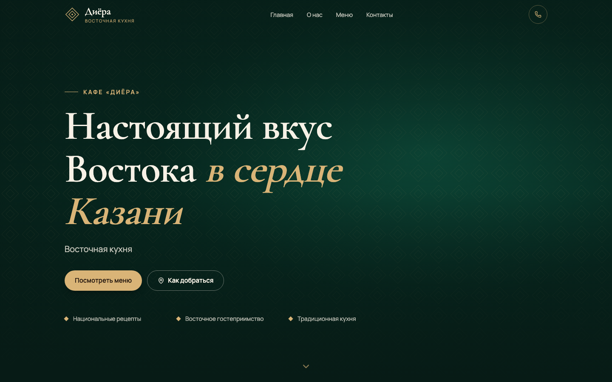
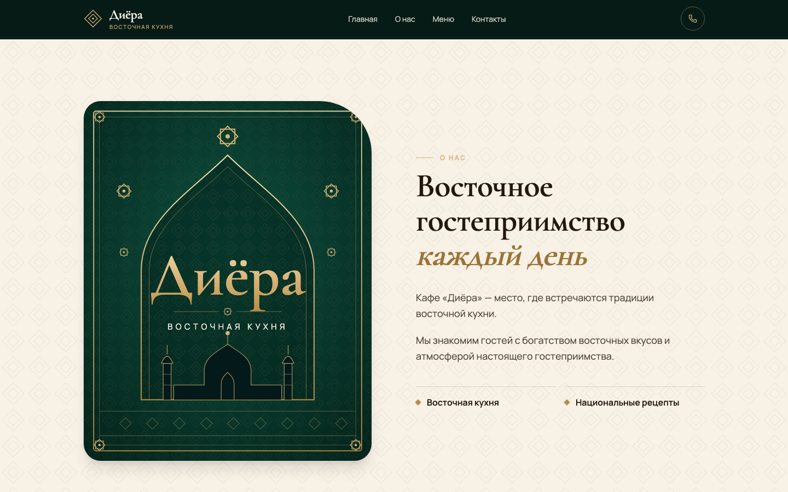
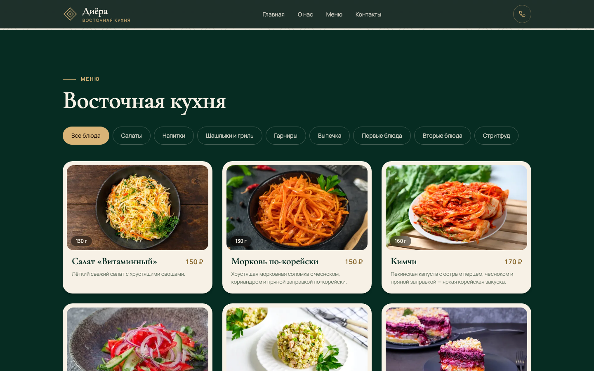
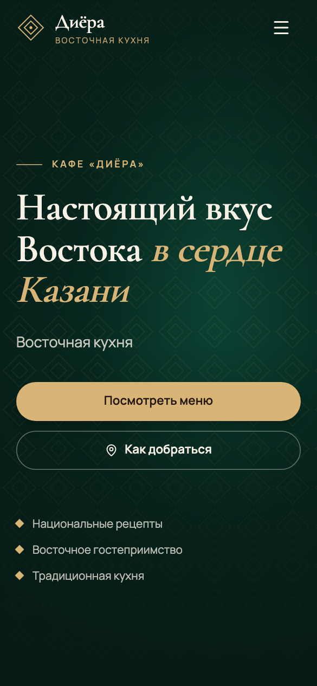

# Диёра — сайт кафе

Одностраничный сайт кафе «Диёра»: меню с фото и граммовками (плов, казан-кебаб, стритфуд, напитки и др.), раздел «О нас» и контакты с Telegram.

**Живой сайт:** https://diyora-mu.vercel.app

## Скриншоты



| О нас | Меню |
| --- | --- |
|  |  |

Мобильная версия:



## Стек

- Next.js 16 (App Router) + React 19
- TypeScript
- Tailwind CSS 4
- Motion (анимации), lucide-react (иконки)
- Деплой: Vercel

## Запуск

```bash
npm install
npm run dev
```

Открыть [http://localhost:3000](http://localhost:3000).

## Сборка

```bash
npm run build
npm start
```
